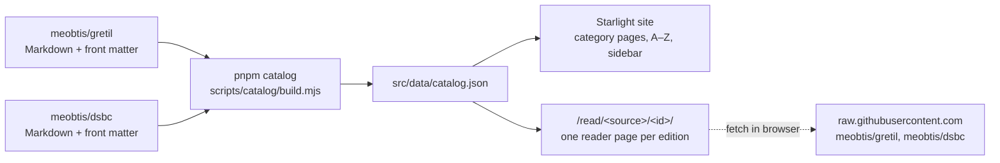

# MEOBTIS

**Markdown Editions Of Buddhist Texts In Sanskrit**: <https://meobtis.github.io>

MEOBTIS is an index of Buddhist texts in Sanskrit from several digital collections. Each
collection is converted to Markdown in its own repository in the
[meobtis](https://github.com/meobtis) organisation. This repository is the website that
merges them into one catalogue, organised by category, and lets you read every text.

Each text is listed **once**, with a link to every edition of it, and each link names its
source (`GRETIL`, `DSBC`, `DSBC देवनागरी`, …). An edition link opens a reader page that
fetches the Markdown from the source repository and renders it in the browser. **No texts
are stored in this repository or in the deployed site**, only the index
(`src/data/catalog.json`: titles, categories and links).

## Sources

| Source | Markdown repository | Original |
| :--- | :--- | :--- |
| GRETIL: Göttingen Register of Electronic Texts in Indian Languages | [meobtis/gretil](https://github.com/meobtis/gretil) | <https://gretil.sub.uni-goettingen.de/gretil.html> |
| DSBC: Digital Sanskrit Buddhist Canon (IAST and Devanāgarī) | [meobtis/dsbc](https://github.com/meobtis/dsbc) | <https://www.dsbcproject.org> |

The texts are subject to their sources' terms. GRETIL texts carry a licence in each file,
mostly CC BY-NC-SA 4.0. DSBC texts are for non-commercial educational and research use;
see the [DSBC usage policy](https://www.dsbcproject.org/pages/usage-policy).

## How it works



1. **Load.** `pnpm catalog` clones or updates each source repository into `.cache/sources/`
   (git-ignored). It reads the YAML front matter of every Markdown file under `texts/`
   (title, author, script, source category, original URL) and turns it into an *edition*
   record.
2. **Merge.** Editions of the same work are grouped by a normalised title key
   (`scripts/catalog/text.mjs`). The key transliterates Devanāgarī to IAST, folds nasal
   variants (ṃ ṁ ṅ ñ ṇ), strips diacritics, *ārya* / *śrī* / *nāma* and case endings
   (*-sūtram*, *-ḥ*). So `Abhisamayālaṅkāravṛttiḥ sphuṭārthā`,
   `Abhisamayālaṃkāravṛttiḥ sphuṭārthā` and `अभिसमयालङ्कारवृत्तिः स्फुटार्था` become one
   work.
3. **Classify.** Each work gets a category in the MEOBTIS taxonomy
   (`scripts/catalog/taxonomy.mjs`), in this order of preference:
   1. a manual override;
   2. DSBC's own category (Sūtrapiṭaka › Avadāna, Śāstrapiṭaka › Pramāṇa, …);
   3. title and author rules for GRETIL texts (`scripts/catalog/classify.mjs`), since
      GRETIL itself only distinguishes "religious literature" from "philosophy".
4. **Write.** The result is written to `src/data/catalog.json`, which is committed. The
   site builds every page and the sidebar from it, so no texts are written into pages by
   hand.
5. **Read.** Astro builds a static reader page for each edition at
   `/read/<source>/<sourceId>/` (`src/pages/read/[...slug].astro`). It holds only the
   catalogue entry: title, author, category, and links to GitHub, the original website
   and the other editions. In the browser, `src/components/TextReader.astro` fetches the
   Markdown from `raw.githubusercontent.com` (served with `Access-Control-Allow-Origin: *`).
   It shows the YAML front matter as "Edition details", renders the text with
   [marked](https://marked.js.org), sanitises the HTML with
   [DOMPurify](https://github.com/cure53/DOMPurify), and builds a contents list from the
   headings. The reader therefore always shows the current text in the source repository,
   even before the index is rebuilt. Reader pages are left out of the site search, so each
   text is found once, through its index entry.

Cases the rules get wrong are corrected in
[`scripts/catalog/overrides.mjs`](scripts/catalog/overrides.mjs). The overrides can merge
editions the key misses, split editions it wrongly joins, and override a category, a
title or an edition label. `pnpm catalog --report` lists every work merged across sources
and any work that could not be classified.

### Introductions

Researched introductions to works, covering what a text is and the history of each digital
edition, live in **this** repository as sidecar files, one per work, in
`src/content/introductions/`. The texts in the source repositories stay untouched. This is
deliberate:

- **Not in the texts' front matter:** that would change the converted texts, and mix
  researched prose with the metadata copied from GRETIL or the DSBC.
- **Not beside the texts in the source repositories:** an introduction describes a *work*,
  which this site defines by merging editions, while its editions are spread across
  several repositories.
- **Rendered at build time,** unlike the texts, so introductions are in the static HTML and
  can be found by search engines and the site search.

Each file is validated against the schema in `src/content.config.ts`:

```markdown
---
title: Prajñāpāramitāhṛdayasūtra
englishTitle: The Heart Sūtra            # best-known English title
refs: [gretil:sa_…, dsbc:70, dsbc:71]    # editions of the work; all must be in one work
summary: One sentence, shown in text lists and as the page description.
editions:                                # optional history of individual editions
  - ref: dsbc:70
    history: Based on P. L. Vaidya's edition (1961).[^vaidya1961] …
updated: 2026-11-13
---

A few paragraphs describing the work, citing sources as footnotes.[^nattier1992]

[^nattier1992]: Nattier, J. (1992). The Heart Sūtra: A Chinese apocryphal text? *Journal of the International Association of Buddhist Studies, 15*(2), 153–223. https://…
[^vaidya1961]: Vaidya, P. L. (Ed.). (1961). *Mahāyāna-sūtra-saṃgrahaḥ* (Pt. 1; Buddhist Sanskrit Texts 17). Mithila Institute …
```

The body describes the work. Sources are cited as **Markdown footnotes** whose
definitions, at the end of the body, are full **APA 7** references; edition histories cite
the same footnotes. Reader pages show the English title under the
Sanskrit title, and the introduction above the text: the description, the history of the
edition being read, and a numbered **References** list of only the sources cited there
(rendered with `marked-footnote`), with a note that introductions are based on internet
research and may be inaccurate (explained on the About page). Text lists show the English
title and the summary. The build fails if an introduction names an unknown edition, spans
two works, duplicates another, cites a footnote without a reference, or defines a
reference it never cites; `pnpm intros check` also checks the APA 7 shape of each reference.

Introductions are written with the **`augment-text`** Claude Code skill
(`.claude/skills/augment-text/`). It finds the work and its editions, reads each edition's
own metadata, researches the work on the web, and writes the file with the English title
and an APA 7 footnote for every claim. Run it with `/augment-text <title>`, or ask for, e.g.,
"introductions for the next 5 texts in sutra/prajnaparamita".

### Taxonomy

| Group | Categories |
| :--- | :--- |
| Sūtra | Āgama · Mahāyāna sūtras · Prajñāpāramitā · Dhāraṇī · Avadāna · Jātaka · Life of the Buddha |
| Vinaya | Prātimokṣa and karmavācanā · Vinayavastu · Other Vinaya texts |
| Śāstra | Abhidharma · Madhyamaka · Yogācāra · Madhyamaka–Yogācāra · Pramāṇa · Prajñāpāramitā commentaries · Lekha · Other treatises |
| Tantra | Tantras (by class) · Tantra commentaries (by class) · Sādhana and ritual · Songs of realisation |
| Stotra | Hymns to the Buddha · to bodhisattvas · to goddesses and deities (by deity) |
| Literature | Kāvya · Nāṭaka · Nīti and subhāṣita |
| Sciences | Vyākaraṇa · Alaṃkāra and chandas · Jyotiṣa · Cikitsā · Śilpa |
| Other | Modern works · Miscellaneous |

Empty categories are hidden.

## Adding a source

1. Convert the collection to Markdown in a new `meobtis/<name>` repository. Put the texts
   under `texts/`, each with YAML front matter giving at least a title, a script and the
   original URL.
2. Add an adapter to `SOURCES` in
   [`scripts/catalog/sources.mjs`](scripts/catalog/sources.mjs) that maps the front matter
   to edition records (see the comment at the top of that file). If the source has its own
   categories, map them in `taxonomy.mjs`.
3. Run `pnpm catalog --report`, review the merges, add overrides where needed, and commit
   the regenerated `src/data/catalog.json`.

## Project structure

```
.
├── .github/workflows/deploy.yml   # build and deploy to GitHub Pages on push to main
├── scripts/catalog/               # catalogue builder
│   ├── build.mjs                  #   entry point: load → merge → classify → write
│   ├── sources.mjs                #   one adapter per source repository
│   ├── taxonomy.mjs               #   groups, categories, DSBC category mapping
│   ├── classify.mjs               #   rules for texts without a source category
│   ├── overrides.mjs              #   manual merges, splits, categories, titles
│   └── text.mjs                   #   Devanāgarī → IAST, title normalisation
├── .claude/skills/augment-text/   # Claude Code skill that writes introductions
├── scripts/introductions.mjs      # find/missing/check/status helper for introductions
├── src/
│   ├── content/introductions/     # researched introductions, one Markdown file per work
│   ├── data/catalog.json          # generated catalogue (committed)
│   ├── lib/catalog.ts             # typed access to the catalogue
│   ├── components/
│   │   ├── Footer.astro           # Starlight footer plus source credits
│   │   ├── Head.astro             # adds the Noto fonts (Astro Fonts API)
│   │   ├── Introduction.astro     # introduction section on reader pages
│   │   ├── TextReader.astro       # fetches and renders an edition's Markdown in the browser
│   │   └── WorkList.astro         # list of works with their edition links
│   ├── pages/texts/               # /texts/, /texts/all/, /texts/<group>/<category>/
│   ├── pages/read/                # /read/<source>/<sourceId>/: one reader page per edition
│   ├── content/docs/              # home page, About and Sources (MDX)
│   └── styles/rosely.css          # Rosely colours for Starlight
└── astro.config.mjs               # Starlight config; sidebar generated from the catalogue
```

Built with [Astro](https://astro.build) and [Starlight](https://starlight.astro.build),
using the [Rosely](https://rosely.hellotham.com) palette and the Noto Sans, Noto Sans
Devanagari and Noto Sans Mono fonts.

## Commands

| Command | Action |
| :--- | :--- |
| `pnpm install` | Install dependencies |
| `pnpm catalog` | Fetch the source repositories and regenerate `src/data/catalog.json` |
| `pnpm catalog --offline` | Regenerate from the existing checkouts in `.cache/sources/` |
| `pnpm catalog --report` | Also list merges across sources and unclassified works |
| `pnpm intros find <title>` | Show a work's edition refs and Markdown URLs (for introductions) |
| `pnpm intros missing [group/category]` | List works without an introduction |
| `pnpm intros check` | Validate all introductions |
| `pnpm intros status` | Introduction coverage by category |
| `pnpm dev` | Start the dev server at `localhost:4321` |
| `pnpm build` | Build the site to `./dist/`, including the search index |
| `pnpm preview` | Preview the build locally (search works only in a build) |

## Deployment

Every push to `main` builds and deploys the site with GitHub Actions. In the repository's
**Settings → Pages**, set **Source** to **GitHub Actions**. The workflow builds from the
committed `catalog.json` and does not fetch the sources. Run `pnpm catalog` and commit the
result to update the index. Changes to a text in a source repository need no rebuild,
because reader pages fetch the text when they are opened. Rebuild only when texts are
added, removed or renamed.

## Credits

- **Texts:** all texts belong to their sources, and the reader shows each edition's source,
  terms and contributors.
  - [GRETIL](https://gretil.sub.uni-goettingen.de/gretil.html), the Göttingen Register of
    Electronic Texts in Indian Languages, maintained by the Göttingen State and University
    Library (SUB Göttingen), and its contributors. The licence is given in each text, mostly
    CC BY-NC-SA 4.0.
  - The [Digital Sanskrit Buddhist Canon](https://www.dsbcproject.org), a project of the
    University of the West with the Nagarjuna Institute, Kathmandu, and its input and
    proof-reading staff. For non-commercial educational and research use; see the
    [usage policy](https://www.dsbcproject.org/pages/usage-policy).
- **Logo and share image:** detail of a Sanskrit manuscript of the
  *Prajñāpāramitāhṛdaya* (Heart Sūtra) in Siddhaṃ script, Bibliothèque nationale de France
  ([Gallica](https://gallica.bnf.fr/ark:/12148/btv1b8305799x)). Public domain, via
  [Wikimedia Commons](https://commons.wikimedia.org/wiki/File:Prajnyaapaaramitaa_Hridaya_Pel.sogd.jpg). Used as `public/meobtis-square.jpeg` (logo and icons) and
  `public/meobtis-og.jpeg` (Open Graph image).
- **Theme:** [Rosely](https://rosely.hellotham.com) palette.
- **Fonts:** Noto Sans, Noto Sans Devanagari and Noto Sans Mono (SIL Open Font License).

## Contributing

Report errors in the index or suggest a source by
[opening an issue](https://github.com/meobtis/meobtis.github.io/issues). Errors in a
converted text belong in the repository of its source.
